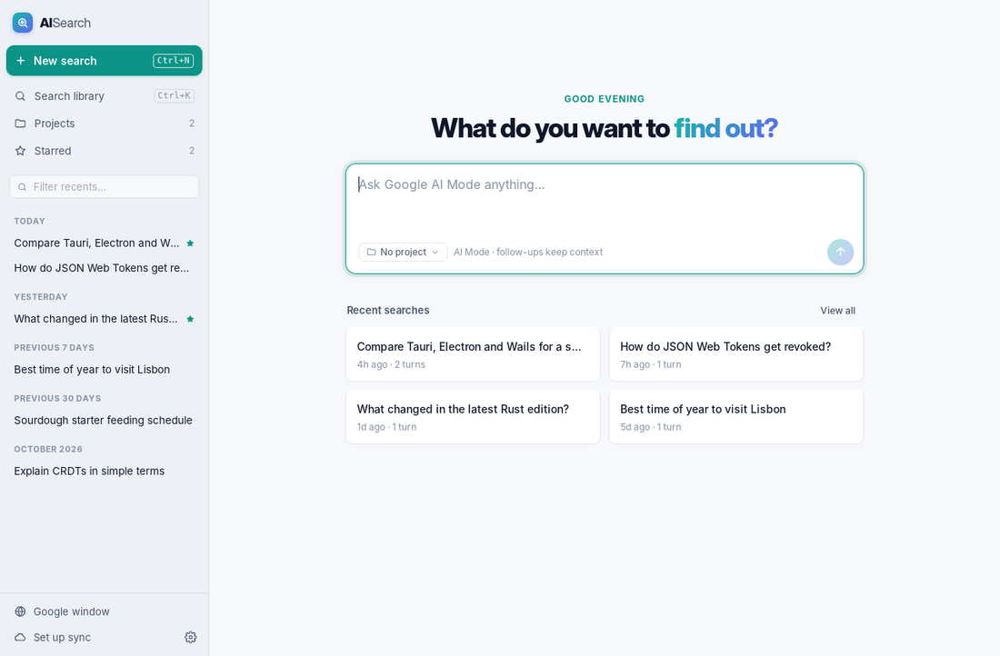
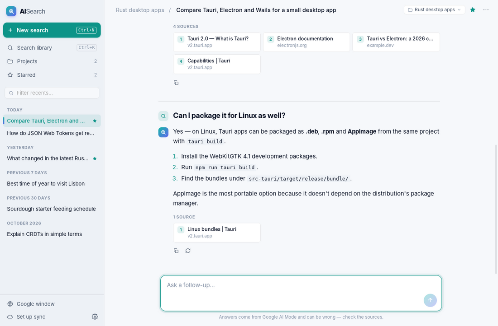
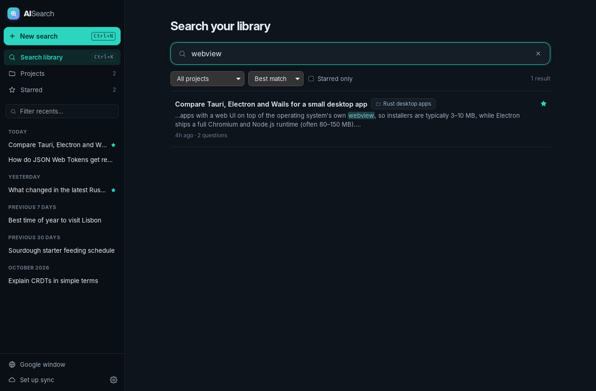

# AI Search

A lightweight desktop app for **Google AI Mode** on macOS and Linux. Ask questions with back-and-forth
follow-ups, and every conversation is saved to a local, Claude-style library: projects, starred items and
full-text search. The library can optionally sync to **GitHub** and **JSONBin.io**.



| Conversation | Library search (dark theme) |
| --- | --- |
|  |  |

## Why Tauri (and not Electron)

AI Search is built with [Tauri 2](https://v2.tauri.app) and Svelte 5. Instead of bundling Chromium, it uses the
web engine the OS already has (WebKit on macOS, WebKitGTK on Linux), with a small Rust core.

| | AI Search (Tauri) | Typical Electron app |
| --- | --- | --- |
| Installer | ~3.4 MB (.deb / .rpm, measured) | 80–150 MB |
| Idle memory | ~40–80 MB | 150–300 MB |
| Frontend JS | ~80 KB gzipped | — |

## Features

- **Google AI Mode search and follow-ups.** Answers stream in as they're written. Follow-ups continue the same
  Google AI Mode thread. If that thread is gone (for example after a restart), the app opens a new one and
  includes your earlier questions as context, so nothing is lost.
- **A Claude-style library.** You get a "New search" home, recents grouped by date, **projects** (with
  descriptions and optional *instructions* added to the first question of each new search), stars, renaming,
  moving searches between projects, and Markdown export.
- **Full-text search** across titles, questions, answers, tags and project names. It's fuzzy and
  prefix-matching, with highlighted snippets (⌘/Ctrl K).
- **Sources** are captured for every answer and open in your normal browser.
- **Plain files you own.** Each conversation is a JSON file with a readable `.md` copy next to it.
- **Sync** to a GitHub repository (one commit per sync through the API, so git doesn't need to be installed)
  and/or JSONBin.io. Sync works in both directions: conversations are merged per message, and deletions
  propagate.
- Light and dark themes, plus keyboard shortcuts: ⌘/Ctrl N (new search), ⌘/Ctrl K (search),
  ⌘/Ctrl , (settings), Shift ⏎ (new line).

## How the Google part works

Google has no public AI Mode API, so AI Search drives the **normal AI Mode web page** in a dedicated, persistent
Google window inside the app:

```
 ┌──────────── main window (Svelte UI) ────────────┐        ┌────── "google" window ───────┐
 │ you type a question                             │ invoke │ https://www.google.com/      │
 │   → google_ask (Rust) ──────────────────────────┼───────►│   search?udm=50&q=…          │
 │                                                 │        │ + injected bridge script:    │
 │ ◄── "google-report" events: partial / done ─────┼────────┤   watches the answer,        │
 │     (answer as Markdown + sources)              │ bridge_│   converts it to Markdown,   │
 │                                                 │ report │   types follow-ups           │
 └─────────────────────────────────────────────────┘        └──────────────────────────────┘
```

- The Google window has its own cookie store, which is kept between runs. It's **hidden** by default. It
  **pops up by itself** when Google needs you (cookie consent, a CAPTCHA), and the search carries on once
  you've dealt with it. Open it from the sidebar (**Google window**) to sign in to your Google account or
  watch a search.
- Security: Google's page can call **exactly one** app command (`bridge_report`, which only passes results to
  the UI). That limit is enforced by Tauri's capability system
  ([`src-tauri/capabilities/google.json`](src-tauri/capabilities/google.json)). The page can't read or write
  your files or tokens.
- The bridge script is [`src-tauri/src/bridge/google_bridge.js`](src-tauri/src/bridge/google_bridge.js). It
  finds the answer through CSS selectors that you can edit in **Settings → Google → Advanced** (the default
  is `div[data-subtree="aimc"]`), and falls back to a generic method if they stop matching. Google changes its
  markup from time to time. When it does, you can usually fix the app by changing the selectors, without
  rebuilding. **Save page snapshot** writes the current Google page to `<library>/.aisearch/debug/` so you can
  inspect it.

> AI Search is not affiliated with Google. It automates Google's regular web page in your own session, so
> Google's Terms of Service apply. Use it for personal research, at a human pace.

## The library on disk

The default location is `~/Documents/AI Search`. You can change it in **Settings → General**.

```
AI Search/
├── .aisearch/
│   ├── library.json                 format marker
│   └── deleted.json                 deletion records (so deletions sync)
├── searches/                        searches that aren't in a project
│   ├── 2026-11-26-how-do-jwts-get-revoked--3f2a9c1d.json
│   └── 2026-11-26-how-do-jwts-get-revoked--3f2a9c1d.md
└── projects/
    └── rust-desktop-apps--7a1c2e90/
        ├── project.json
        ├── README.md
        ├── 2026-11-26-compare-tauri-electron--c0ffee01.json
        └── 2026-11-26-compare-tauri-electron--c0ffee01.md
```

Records are identified by the `id` inside each file. File names are only there to make the folder readable,
so renaming a search or moving it to another project just moves the file. The `.md` copies are generated and
never read back. **Reload from disk** (Settings → General) picks up any edits you make outside the app.

## Sync

| | GitHub | JSONBin.io |
| --- | --- | --- |
| Setup | Fine-grained token with **Contents: Read and write** on one repo, plus owner, repo, branch and folder | Your **X-Master-Key** |
| Layout | The library folder mirrored under `library/` (browsable on github.com) | A manifest bin plus ~90 KB chunk bins (the free plan caps records at 100 KB) |
| Efficiency | Only files whose git blob hash changed are downloaded or uploaded; one commit per sync | Only changed chunks are downloaded or uploaded (JSONBin bills per request) |
| Second computer | Same repo settings | Paste the **manifest bin ID** shown in Settings |

How merging works:

- **Projects:** the newest edit wins.
- **Conversations:** title, project and star come from the newest copy. Messages are the **union** of both
  copies, so turns added on two machines are all kept.
- **Deletions:** stored as tombstones. A record is removed when its tombstone is newer than its last edit.

Turn on **Sync automatically** to sync at start-up and about 20 seconds after each change. Tokens are stored
only in the app's settings file (`~/.config/io.github.kkrampis.aisearch/settings.json` on Linux,
`~/Library/Application Support/io.github.kkrampis.aisearch/` on macOS), with permissions set so only your user
can read it.

## Install and build

Prebuilt installers (`.dmg`, `.deb`, `.rpm`, `.AppImage`) are produced by GitHub Actions for every push. Look
under the run's artifacts, or under Releases for `v*` tags.

To build it yourself:

**Prerequisites**

- [Rust](https://rustup.rs) (stable) and Node.js 20+.
- **macOS:** Xcode Command Line Tools (`xcode-select --install`).
- **Debian/Ubuntu:**
  ```sh
  sudo apt install libwebkit2gtk-4.1-dev build-essential curl wget file libxdo-dev \
                   libssl-dev libayatana-appindicator3-dev librsvg2-dev
  ```
- **Fedora:** `sudo dnf install webkit2gtk4.1-devel openssl-devel curl wget file libappindicator-gtk3-devel librsvg2-devel`
- **Arch:** `sudo pacman -S webkit2gtk-4.1 base-devel curl wget file openssl appmenu-gtk-module libappindicator-gtk3 librsvg`

**Run and build**

```sh
npm install
npm run app:dev        # development, with hot reload
npm run app:build      # release installers in src-tauri/target/release/bundle/
```

**Tests**

```sh
npm test                                        # search, utilities, and the Google bridge (run in jsdom)
npm run check                                   # Svelte / TypeScript type check
cargo test --manifest-path src-tauri/Cargo.toml # library storage, merge, sync packing
```

## Troubleshooting

- **"No response from the Google window"**: open the Google window from the sidebar. It's usually waiting for
  you to accept a consent screen, solve a CAPTCHA or sign in.
- **Answers are cut off**: increase *Answer is final after it stops changing for (ms)* in Settings → Google.
- **Answers stall while the window is hidden**: some systems slow down hidden web views. Turn on *Keep the
  Google window visible while searching*.
- **Nothing gets captured, or the note says "generic fallback"**: Google probably changed its page. Save a page
  snapshot and update the selectors in Settings → Google → Advanced.
- **AI Mode isn't available**: AI Mode isn't offered for every account, country or language yet. Try another
  `hl` value, or sign in through the Google window.

## Project layout

```
src/                      Svelte 5 UI
  lib/state.svelte.ts     app state and library actions
  lib/google.svelte.ts    search jobs, follow-ups, recovery
  lib/search.ts           MiniSearch full-text index and snippets
  components/             sidebar, chat, projects, search, settings…
src-tauri/
  src/library.rs          on-disk library (JSON + Markdown mirrors)
  src/merge.rs            conflict resolution
  src/sync/github.rs      GitHub Git Data API sync
  src/sync/jsonbin.rs     JSONBin chunked sync
  src/google.rs           Google window management
  src/bridge/google_bridge.js   script injected into the Google window
  capabilities/           what each window may call
```
